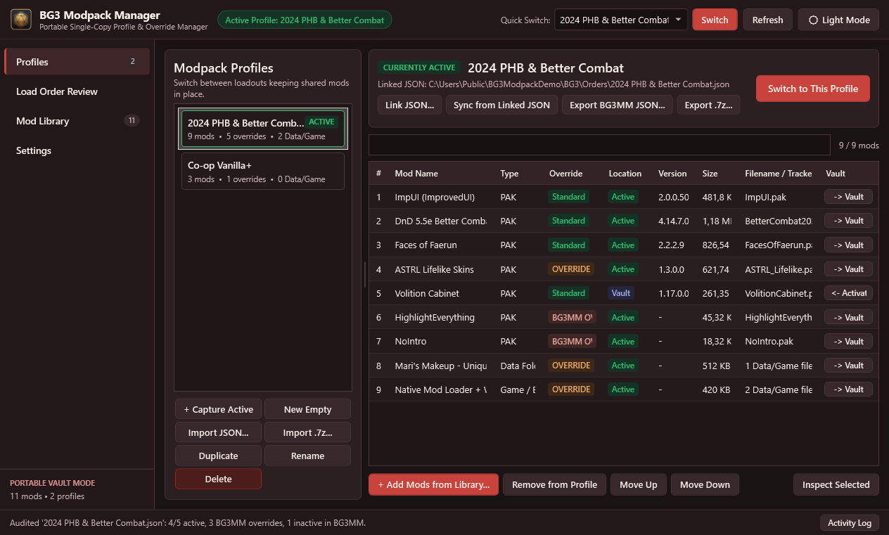
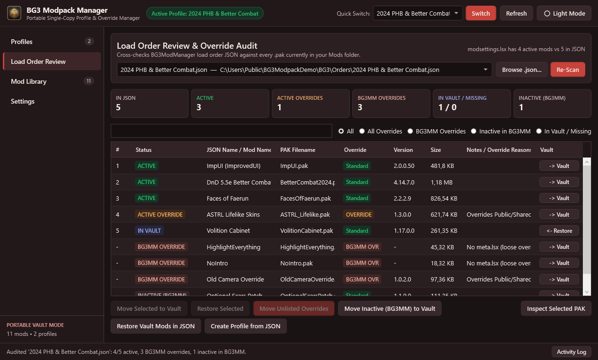
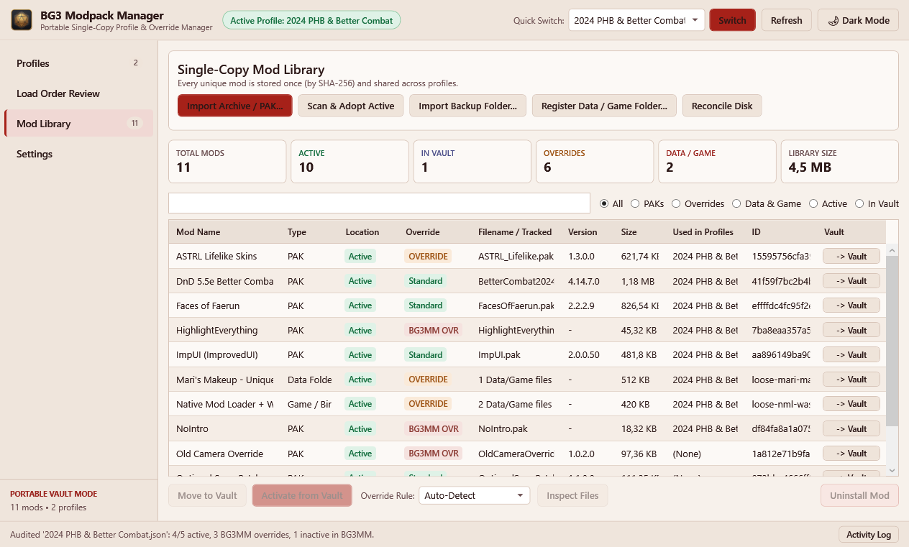
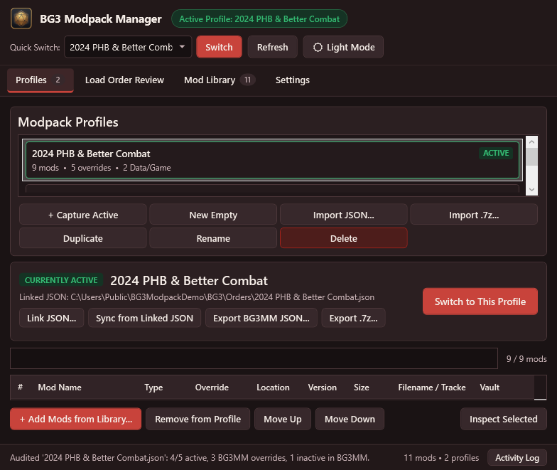

<div align="center">
  

  # BG3 Modpack Tools

  **Portable Windows modpack profile switcher, override detector, and single-copy Vault toolkit for Baldur's Gate 3**

  
  
  -D97706)
  
  
</div>

---

> [!WARNING]
> **Early Preview / Vibe Coded — Needs Broader Testing**
>
> This project was **vibe coded** (built iteratively with AI assistance) to replace manual `.bat` scripts for switching between Baldur's Gate 3 modpack profiles.
>
> It **seems to be working well so far** in local use and passes an automated 7-suite sandbox test harness, and it is designed with non-destructive safety mechanisms (in-place `.bg3mpm_orig` backups of replaced game files, automatic `modsettings.lsx.bak` backups, and a running-game process guard). **However, it still needs wider community testing across different mod setups.** Please back up your BG3 `Mods` folder, `Data` folder, `bin` folder, and `modsettings.lsx` before experimenting, and feel free to open an issue if you run into any bugs!

---

## Why BG3 Modpack Tools?

In **Baldur's Gate 3**, simply removing a `.pak` from your active load order in **BG3ModManager** does not always prevent the game from loading it:
- **Override `.pak` files** (mods that override `Public/Shared/`, `Mods/GustavDev/`, `Video/`, or lack a `meta.lsx`, such as *HighlightEverything*, *NoIntro*, *Mod Configuration Menu*, *ASTRL Lifelike*, or *Unique Tav / KAVT*) are loaded automatically whenever they sit inside your `Mods` folder.
- **Loose `Data/` and `bin/` mods** (such as *Mari's Makeup/Tattoo*, *Unique Tav* loose assets under `Data/Generated/`, *Native Mod Loader* `bink2w64.dll`, *Native Camera Tweaks*, *WASD Character Movement*, and *BG3 Script Extender*) live directly inside the game installation directory and must be parked out of the way when switching to a vanilla or co-op profile.

**BG3 Modpack Tools** works alongside **BG3ModManager** `.json` load orders to switch full profiles cleanly while keeping **only one single copy of each mod on disk** (keyed by SHA-256 content hash). Shared mods across two profiles stay untouched in place with zero redundant file copying.

---

## Screenshots

### Modpack Profiles (Dark Mode)
Manage multiple modpack loadouts, link or import BG3ModManager `.json` orders, export/import complete `.7z` modpack archives, and switch profiles with a full preview of what stays in place, moves to the Vault, or activates.



### BG3ModManager Load Order Review
Audit any BG3MM `.json` order against your live `Mods` folder, Vault, and `modsettings.lsx`. Instantly spot **Active Overrides**, **BG3MM Standalone Overrides**, **In Vault** mods, and **Unlisted Overrides** lurking in your `Mods` folder, and move unwanted files to the Vault one-by-one or in bulk.



### Single-Copy Mod Library (Light Mode)
Every unique `.pak`, loose `Data/` mod, and `Game/bin/` native plugin is tracked once by SHA-256 hash (even distinguishing variants that share the exact same filename and UUID, such as *KAVT* vs original `unique_tav.pak`).



### Responsive / Compact Half-Screen Layout
Adapts down to a compact `760 × 540` window for half-screen Windows Snap, automatically switching the left sidebar into a top horizontal navigation bar and stacking the Profiles workspace.

<div align="center">
  
</div>

---

## Key Features

- **Single-Copy Mod Library & Vault (`Mods-off` Storage)**
  - Deduplicates mods by **SHA-256 content hash** so mods shared across multiple profiles are stored only once.
  - Shared mods remain untouched in place when switching profiles (zero redundant disk I/O).
  - Moves inactive override `.pak` files, loose `Data/` files, and `Game/bin/` files to a portable `Vault/` directory (on the same drive as BG3 for instant atomic moves, or verified copy + delete across drives).
- **Pure C# LSPK (`.pak`) v15 / v16 / v18 Inspector & Override Detector**
  - Parses `.pak` headers, LZ4/Zlib file tables, and embedded `meta.lsx` directly without external native DLLs.
  - Automatically classifies **Standard** mods, **Merged Overrides** (listed in BG3MM JSON + overriding base-game paths), and **Standalone BG3MM Overrides** (e.g., *HighlightEverything*, *NoIntro* — loaded from `Mods/` without appearing in the JSON `Order` array).
  - Ignores harmless custom icon packs under `Public/Game/GUI/Assets/...`.
- **Drag & Drop Mod Installer (`.zip`, `.7z`, `.rar`, `.pak`, Folders)**
  - Drag one or multiple archives downloaded from NexusMods directly onto the window.
  - Automatically detects and routes `.pak` files to `Mods/`, `Generated`/`Public`/`Localization`/`Video` trees to BG3 `Data/`, and `bin`/`NativeMods` files to the BG3 `Game` folder (or bundles a `.pak` + loose files into a single **Hybrid** mod).
  - Asks once after a batch import whether you want to delete the original `.zip` / `.7z` archive file(s).
- **Full `.7z` Modpack Profile Export & Import**
  - Export any profile into a self-contained `.7z` archive containing its `.pak` files, tracked loose mods, live `Data/Generated/` mod assets (excluding Toolkit editor gizmos), live `Game/bin/` mods (*NativeMods*, *Native Mod Loader*, *Script Extender*), BG3MM `.json` load order, `profile_manifest.json`, and install guide.
  - Re-import exported `.7z` modpacks via the **Import .7z...** button or drag-and-drop with single-copy deduplication.
- **BG3MM Load Order Auto-Sync & Drag-and-Drop Editor**
  - Edit your profile load order directly via BG3MM-style single/multi-row drag-and-drop (`Ctrl+Up`/`Ctrl+Down` or Up/Down buttons) while keeping linked loose `Data/` and `Game/bin/` mods attached at the end.
  - Importing, adding, removing, uninstalling, or reordering mods automatically writes linked BG3ModManager `.json` files (ready for `F5` refresh in BG3MM) and keeps active `modsettings.lsx` synchronized (with `.bak` backups) by default on profile switches.
- **Quick Game Launcher & Folder Shortcuts**
  - Adaptive **Start Baldur's Gate 3** button (configurable between DirectX 11 `bg3_dx11.exe` and Vulkan `bg3.exe` in Settings) alongside one-click **Open Mods Folder**, **Open Game Folder**, and **Open Vault Folder** shortcuts.
- **Non-Destructive Original Game File Replacement (`.bg3mpm_orig`)**
  - When a mod replaces an existing vanilla or untracked game file (such as *Native Mod Loader* replacing `bin\bink2w64.dll` or loose textures replacing files under `Data\Generated\`), the original file is never overwritten — it is renamed in place to `*.bg3mpm_orig` and recorded on the mod entry.
  - Moving the mod to the Vault or clicking **Uninstall Mod** automatically restores the original game file byte-for-byte and prunes empty mod subdirectories (while preserving base folders like `Data\Generated\Public\Shared`).
- **Baldur's Gate 3 Running Guard (Vulkan & DX11)**
  - Monitors both `bg3.exe` and `bg3_dx11.exe` in real time and blocks file-moving operations until the game is closed.
- **Custom Dark & Light Themes + Multi-Language Support**
  - Live switchable **Dark** and **Light** color themes.
  - Built-in **English (`en`)** and **Hungarian (`hu`)** translations (remembers your last used language, defaulting to English), plus one-click **Export Template** for adding new community JSON language packs.

---

## Requirements & Quick Start

### Requirements
- **OS:** Windows 10 or Windows 11 (x64)
- **Runtime:** [.NET 8.0 Windows Desktop Runtime](https://dotnet.microsoft.com/en-us/download/dotnet/8.0)
- **7-Zip (Recommended):** [7-Zip](https://www.7-zip.org/) (`C:\Program Files\7-Zip\7z.exe`) is used for `.7z` / `.rar` archive extraction and `.7z` modpack profile exports.

### Running From Source or Publishing Portable `.exe`

```powershell
# 1. Clone the repository
git clone https://github.com/kobalint/BG3ModpackManager.git
cd BG3ModpackManager

# 2. Build the solution
dotnet build BG3ModpackTools.sln -c Release

# 3. Run the automated 7-suite sandbox test harness
dotnet run --project tests\BG3ModpackTools.Tests\BG3ModpackTools.Tests.csproj -c Release

# 4. Publish the portable single-file executable to .\dist\BG3ModpackTools.exe
.\publish.ps1
```

Place `BG3ModpackTools.exe` in any folder (ideally on the same drive as your BG3 installation so Vault moves are instant atomic renames) and launch it. On first launch it auto-detects your BG3 `Mods`, `Game`, `Data`, `modsettings.lsx`, and BG3ModManager `Orders` directories.

---

## Portable Folder Structure

All application state is stored locally next to `BG3ModpackTools.exe`:

| Path | Description |
| :--- | :--- |
| `BG3ModpackTools.exe` | Portable single-file WPF executable |
| `data\settings.json` | Configured BG3 & BG3MM paths, switch mode, theme, and last used language (`en` default) |
| `data\library.json` | Single-copy mod database, tracked loose file manifests, `.bg3mpm_orig` backup records, and profiles |
| `data\pak-cache.json` | Cached LSPK metadata and SHA-256 hashes for fast startup scans |
| `data\languages\*.json` | Optional drop-in custom/community translation files |
| `Vault\` | Default single-copy `mods-off` storage (`Vault\paks\`, `Vault\data\`, `Vault\game\`, `Vault\_backups\`) |

---

## Adding a New Language

1. Open **Settings** in the app and click **Export Template** (next to the language selector).
2. This creates `data\languages\template_en.json` with all UI keys.
3. Copy and rename it to a language code (for example `data\languages\de.json` or `data\languages\fr.json`), update `"code"`, `"nativeName"`, and `"englishName"` at the top, and translate the string values (keeping `{0}`, `{1}` placeholders intact).
4. Click **Reload** in Settings — your language appears immediately in the dropdown.

---

## Automated Test Suites

The `tests\BG3ModpackTools.Tests` runner executes 7 isolated sandbox test suites (never touching real BG3 folders):
- `LspkReaderTests` — LSPK v16/v18 parsing, `meta.lsx` extraction, LZ4/Zlib decompression, and override classification
- `ArchiveImportTests` — `.zip` & `.7z` import routing, Hybrid mod packaging, zip-slip protection, and `.bg3mpm_orig` backup & uninstall restoration
- `ProfileSwitchTests` — Zero-copy shared mod retention, `unique_tav.pak` variant swapping, loose `Data/` pruning, and `modsettings.lsx` sync with `.bak` backup
- `LoadOrderReviewTests` — BG3MM JSON vs live `Mods/` vs `modsettings.lsx` auditing
- `GameProcessGuardTests` — `bg3.exe` (Vulkan) & `bg3_dx11.exe` (DX11) detection and guard blocking
- `ProfileExportTests` — `.7z` modpack export & import including `Data\Generated\` and `Game\bin\` with non-destructive original file replacement and Vault activation
- `LocalizationTests` — Embedded `en.json` / `hu.json` key & placeholder parity, custom language pack fallback, and settings persistence

---

## License

Released under the [MIT License](LICENSE).
